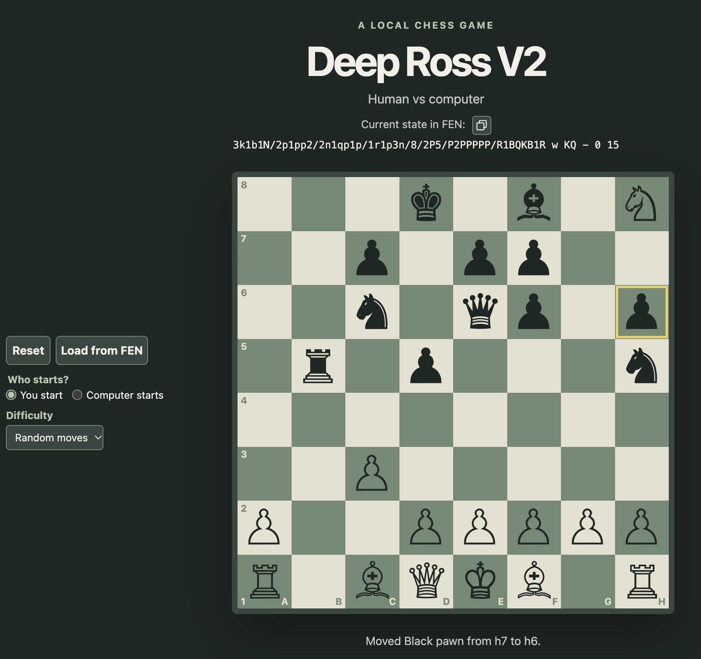

# Deep Ross V2


A browser-based, local-first chess app, for human-vs-computer play.

## Current status

The current version displays the standard chess starting position and supports
moving pieces by dragging or by selecting a piece and destination. Capturing an
opposing piece is supported, with legal moves checked against piece movement
and king safety. Castling, en passant, and all four promotion choices are
implemented. File labels A–H and rank labels 1–8 are shown on the board. Use
the Reset button to restore the original piece positions. The current position
is displayed as FEN and can be copied to the clipboard. The computer opponent
uses iterative-deepening alpha-beta search in a Web Worker. Choose Quick,
Standard, or Strong search limits and whether you or the computer starts using
the controls next to the board. The worker reports completed search depths
without blocking board interaction and is cancelled when a new game is started
or a FEN position is loaded. Load a position using “Load from FEN.” The move
history can be browsed by move, and “Undo” returns to the previous human turn;
you can continue from a browsed position to create a new variation. Download
and load complete game saves, including move history and settings, with the
saved-game controls. Autosave is enabled by default and stores the game and
settings in this browser; turn it off to remove the locally stored game.
Pieces move with a 1 second animation.

The game detects checkmate, stalemate, threefold repetition, the fifty-move
rule, and common insufficient-material draws. A FEN-loaded game starts a fresh
repetition history because FEN does not include prior moves.

Search limits are capped at depth 2 / 350 ms / 20,000 nodes (Quick), depth 4 /
1,500 ms / 120,000 nodes (Standard), and depth 6 / 3,500 ms / 500,000 nodes
(Strong). The first limit reached ends the search iteration and preserves the
best move from the most recently completed depth.

## Run locally

Requirements: Node.js/npm and Python 3 (used by the static development server).
From the project directory, start the server with:

```sh
npm start
```

Open [http://localhost:8000](http://localhost:8000) in your browser. Stop the
server with Ctrl+C.

## Project files

- `src/index.html` — page structure and app title
- `src/styles.css` — responsive page and chessboard styling
- `src/main.js` — coordinates game flow and handles UI interaction
- `src/components/chess-board.js` — `<chess-board>` web component that renders
  the board and handles square selection and piece dragging
- `src/animation.js` — animates pieces between squares for player and computer moves
- `src/fen.js` — parses and serializes Forsyth–Edwards Notation positions
- `src/game.js` — UI-independent game state, legal move generation, move
  application, and FEN access
- `src/game-save.js` — validates versioned save files by replaying their legal
  moves and restores the position timeline
- `src/search.js` — positional evaluation, quiescence, and iterative-deepening
  alpha-beta search with move-ordering heuristics and time/node limits
- `src/search-worker.js` — worker entry point for computer search
- `test/fen.test.js` — FEN parsing and serialization tests
- `test/game.test.js` — game state and move application tests
- `test/game-save.test.js` — save-file round-trip and validation tests
- `test/search.test.js` — search correctness, limits, and terminal-score tests

## Run tests

Run the chess-logic unit tests with Node.js:

```sh
npm test
```

## Project documentation

- [Architecture guide](./architecture.md) — a plain-language explanation of
  the app's modules and how moves, computer search, history, and saves work
- [Implementation plan](./DeepRossV2_plan.md) — original migration notes and
  chess search design details

## Scope

The current project is a local-first game for one human against the computer.
Its rules engine, FEN import/export, move history, browser save/load, autosave,
and Web Worker opponent are implemented. Network play, other player modes,
`.MPC` importing, and the mask utility are outside this version's scope.