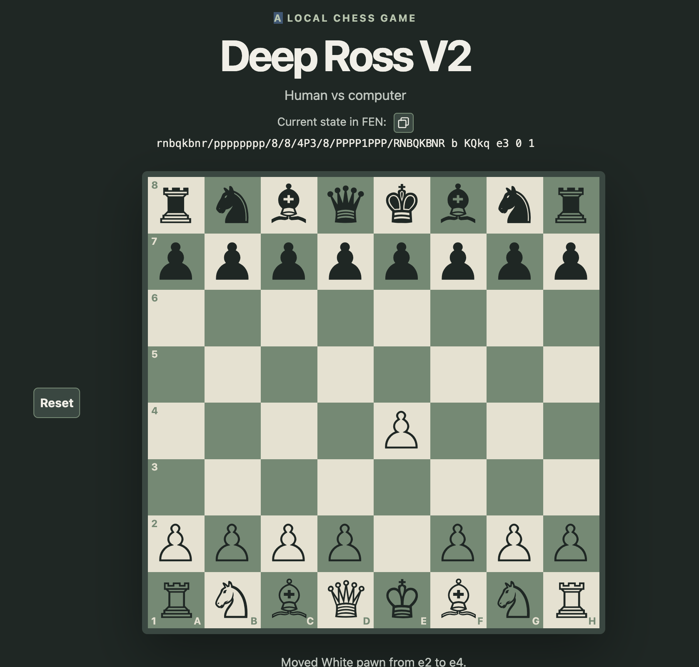

# Deep Ross V2


A browser-based, local-first chess app, for human-vs-computer play.

## Current status

The current version displays the standard chess starting position and supports
moving pieces by dragging or by selecting a piece and destination. Capturing an
opposing piece is supported, with legal moves checked against piece movement
and king safety. Castling, en passant, and all four promotion choices are
implemented. File labels A–H and rank labels 1–8 are shown on the board. Use
the Reset button to restore the original piece positions. The current position
is displayed as FEN and can be copied to the clipboard. The computer opponent
plays random legal moves at the “Random moves” difficulty. Choose whether you
or the computer starts using the controls next to the board. Load a saved
position using the “Load from FEN” button. Pieces move with a 1 second animation.

## Run locally

Requirements: Node.js/npm and Python 3 (used by the static development server).
From the project directory, start the server with:

```sh
npm start
```

Open [http://localhost:8000](http://localhost:8000) in your browser. Stop the
server with Ctrl+C.

## Project files

- `src/index.html` — page structure and app title
- `src/styles.css` — responsive page and chessboard styling
- `src/main.js` — coordinates game flow and handles UI interaction
- `src/board-view.js` — renders the chessboard and FEN display
- `src/animation.js` — animates pieces between squares for player and computer moves
- `src/fen.js` — parses and serializes Forsyth–Edwards Notation positions
- `src/game.js` — UI-independent game state, legal move generation, move
  application, and FEN access
- `src/drag-and-drop.js` — handles pointer-based piece dragging
- `test/fen.test.js` — FEN parsing and serialization tests
- `test/game.test.js` — game state and move application tests

## Run tests

Run the chess-logic unit tests with Node.js:

```sh
npm test
```

## Planned direction

The first milestone is a vanilla JavaScript chessboard backed by a tested rules
engine with full FEN support. The initial game scope is one human playing
against the computer; network play and other modes are not planned for this
version. See [DeepRossV2_plan.md](./DeepRossV2_plan.md) for the broader roadmap.